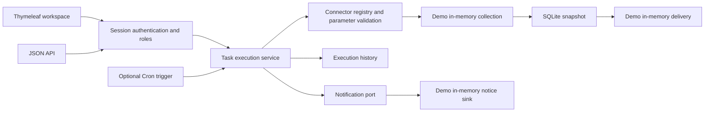

# Operations Center

A small Spring Boot application showing the architecture of a task operations console:
registered connectors, parameter validation, ordered execution, local execution records,
scheduled triggers, notification ports and a server-rendered workspace.

The included `demo` connector generates only `demo-*` / `example-*` records in memory.
Its destination and notification sink are also in memory. No external service is called.

## Architecture



See [architecture](docs/architecture.md) for module boundaries and failure behavior.
The project uses Java 17, Spring Boot, Spring Security, JDBC, SQLite and Thymeleaf.
CSS and templates are local source files; no frontend package manager or remote assets are required.

## Build and verify

With the required Maven artifacts already in the local cache:

```sh
mvn -o -q -DskipTests compile
mvn -o -q test
mvn -o -q -DskipTests package
```

Offline mode never downloads missing artifacts. Tests use a mock servlet environment,
an in-memory SQLite database and generated credentials; they do not bind a network listener.

This standalone demo has no `com.crysound.ops` dependency. For an extension that adds those
Maven coordinates, first run `mvn install` in the open-source `ops-starter` project;
then build the consuming project against that local Maven repository.

## Run the demo

Only `src/main/resources/application.yml` is supplied. Set each required environment variable.
Choose a local bind address and an available port interactively; credentials have no built-in values.
The two usernames must differ, and each password must have at least 12 characters and at
most 72 bytes when encoded as UTF-8 (the BCrypt input limit); a longer password stops startup.
Missing, blank or unresolved identity/password placeholders stop startup. Credential
validation reports a fixed message without including the rejected values.

```bash
read -r -p 'Local bind address: ' OPS_BIND_ADDRESS
read -r -p 'Available HTTP port: ' OPS_HTTP_PORT
read -r -p 'Operator username: ' OPS_OPERATOR_USERNAME
read -r -s -p 'Operator password: ' OPS_OPERATOR_PASSWORD
echo
read -r -p 'Viewer username: ' OPS_VIEWER_USERNAME
read -r -s -p 'Viewer password: ' OPS_VIEWER_PASSWORD
echo
export OPS_BIND_ADDRESS OPS_HTTP_PORT
export OPS_OPERATOR_USERNAME OPS_OPERATOR_PASSWORD OPS_VIEWER_USERNAME OPS_VIEWER_PASSWORD
export OPS_DATABASE_URL='jdbc:sqlite::memory:'
export OPS_DEMO_CRON='-'
java -jar target/ops-center-*.jar
```

Open the root page at the local address and port you selected. Sign in as the operator,
choose a record count and select **Run demo**. The workspace then shows the execution,
the stored records and a matching delivery receipt. Sign in as the viewer to inspect
the same information with read access. All POST requests require the session's CSRF value;
the HTML forms supply it automatically. Authentication uses sessions and form login.

The in-memory database exists only while its physical SQLite connection stays open.
The supplied single-connection pool disables lifetime and idle eviction to retain it
during normal operation. Shutdown or connection loss clears its tables and records;
after connection loss, restart the application to initialize an empty schema.
You can instead supply a SQLite JDBC URL
for a file under a local directory you own. Delivery receipts and notices always reset
on restart and keep only their latest 20 entries. Execution queries return the latest
50 rows; local database retention is the application's operator's responsibility.

## Configuration

| Environment variable | Meaning |
| --- | --- |
| `OPS_BIND_ADDRESS` | Local listener address |
| `OPS_HTTP_PORT` | Selected listener port |
| `OPS_DATABASE_URL` | SQLite JDBC connection string |
| `OPS_OPERATOR_USERNAME` | Identity allowed to read and execute |
| `OPS_OPERATOR_PASSWORD` | Operator credential, at least 12 characters and at most 72 bytes in UTF-8 |
| `OPS_VIEWER_USERNAME` | Distinct identity allowed to read |
| `OPS_VIEWER_PASSWORD` | Viewer credential, at least 12 characters and at most 72 bytes in UTF-8 |
| `OPS_DEMO_CRON` | `-` disables scheduling; a Spring six-field Cron expression enables it in UTC |

The schedule invokes the same demo pipeline as manual execution. It is disabled by
the command above, and the application never runs the connector just by starting up.

## JSON API

| Method and route | Access | Result |
| --- | --- | --- |
| `GET /api/tasks` | Either role | Registered connector IDs and parameter schemas |
| `POST /api/tasks/demo/runs` | Operator + CSRF | Synchronous execution; body `{"size":3}` or `{}` |
| `GET /api/runs` | Either role | Recent execution records |
| `GET /api/runs/{id}` | Either role | One execution |
| `GET /api/runs/{id}/records` | Either role | Its stored snapshot |
| `GET /api/demo/deliveries` | Either role | Bounded in-memory delivery receipts |
| `GET /api/demo/notices` | Either role | Bounded in-memory failure notices |

A completed POST returns HTTP 201 with the execution status, which can be `SUCCESS`
or `FAILED`. Invalid parameters return 400; unknown connector or execution IDs return 404.
Each POST creates a new execution. The demo does not implement submission deduplication
or automatic retries. Use the supplied HTML workspace for the simplest session and CSRF flow.

## Extending the framework

Implement `TaskConnector` with a unique ID and explicit parameter schema, then register
it as a Spring bean. Collection returns generic `DataRecord` values; push receives the
committed snapshot and the execution ID. Implement `NotificationPort` to supply another
notification transport. Keep credentials and destination details outside source control.

Scheduling and execution are single-process examples. Connector implementations execute
inside the application; adding a remote execution adapter is a separate extension.

## License

Licensed under the Apache License 2.0. See [LICENSE](LICENSE).
