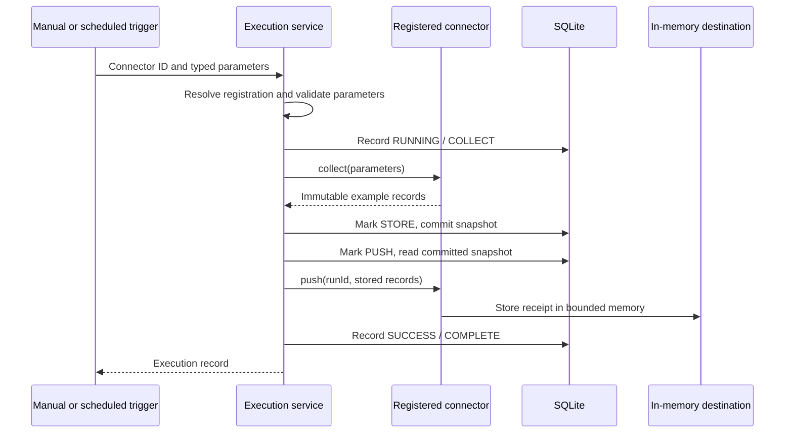

# Architecture

## Layers

| Package or resource | Responsibility |
| --- | --- |
| `integration` | Registered connector interface, record model and parameter schema |
| `execution` | Parameter validation, collection → storage → push orchestration |
| `audit` | JDBC execution history and interrupted-run recovery |
| `storage` | Transactional local snapshots |
| `schedule` | Optional UTC Cron entry into the execution service |
| `alert` | Provider-independent failure notification port |
| `demo` | Synthetic in-memory connector, delivery destination and notice sink |
| `security` | Session authentication, distinct operator/viewer roles and CSRF protection |
| `web` | JSON resources and a Thymeleaf workspace |
| `templates/fragments`, `static/css` | Shared page shell, controls and visual tokens |

## Execution sequence

Only connector IDs registered at startup are accepted. Input cannot select an arbitrary
URL, SQL statement or table. The included connector produces example text records;
the destination and notices retain their latest 20 entries in memory.

The service serializes executions within one process. A snapshot is committed in a
short transaction before push; the orchestration does not hold a transaction across
collection or delivery. A failed collection or storage phase never reaches push.
The two schema tables are `task_run` and `collected_record`; no seeded data is included.
Schema initialization uses Spring JDBC's `schema.sql`, and no Flyway migration is required.

## Failure and lifecycle behavior

An execution failure records `FAILED`, the failed phase, a fixed error code and a
timestamp. It emits a generic notice through `NotificationPort`. Exception messages
and input values are not included in notices or error responses. Notice transport
failure does not overwrite the execution outcome. Storage failures that prevent
recording an outcome return an unavailable response.

On restart, a stored `RUNNING` execution becomes `UNKNOWN` with `INTERRUPTED` as its
error code. The application does not infer delivery success or repeat work. A file
database keeps executions and snapshots. An in-memory database exists only while its
physical SQLite connection stays open. The supplied pool retains one connection with
lifetime and idle eviction disabled. Shutdown or connection loss clears the schema
and records; restart after connection loss to initialize an empty schema.
There is no automatic retry, submission deduplication, distributed lock or distributed
transaction. Each POST starts a fresh run. Delivery is an in-memory demonstration;
external delivery semantics belong to an extension.

## Security and presentation

All task reads require an authenticated operator or viewer. Manual execution requires
the operator role and CSRF protection. Credentials come from environment variables,
are encoded at startup and are never seeded into the database. The schedule is a
server-side entry point restricted to the supplied demo registration.
Before account creation, missing, blank or unresolved identities/passwords and
passwords shorter than 12 characters or longer than 72 UTF-8 bytes stop startup with a fixed validation message.
Validation does not use binding constraints that report rejected credential values.

Thymeleaf escapes record values. Shared fragments and CSS tokens render the task
workspace, login and generic error page without JavaScript, binary assets or external
fonts. The frontend is built and packaged by Maven together with the application.

## Extension boundaries

`TaskConnector` is the collection and delivery extension point. `NotificationPort`
is the failure-notice extension point. The demo is self-contained and has no remote
execution client or identity-provider integration. Any new adapter must supply its
own configuration through the environment and define its failure and retry behavior.
